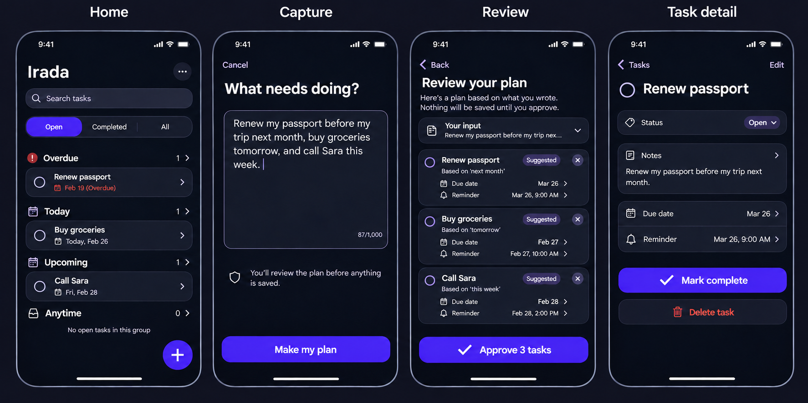
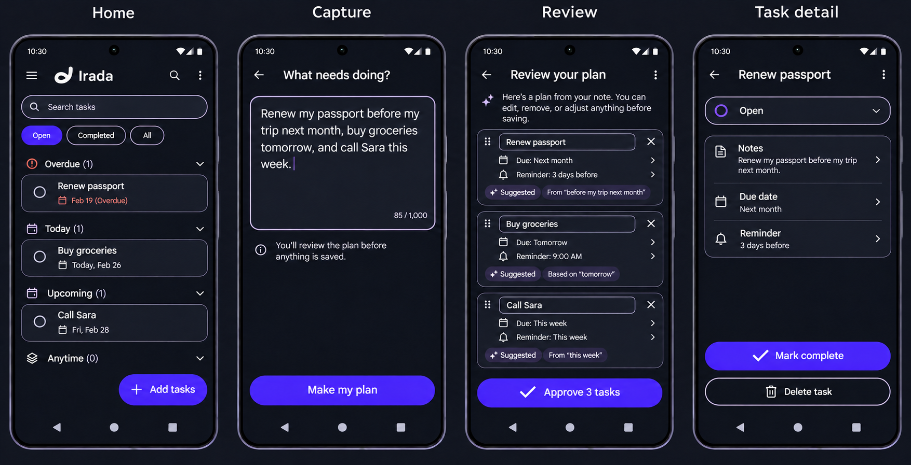
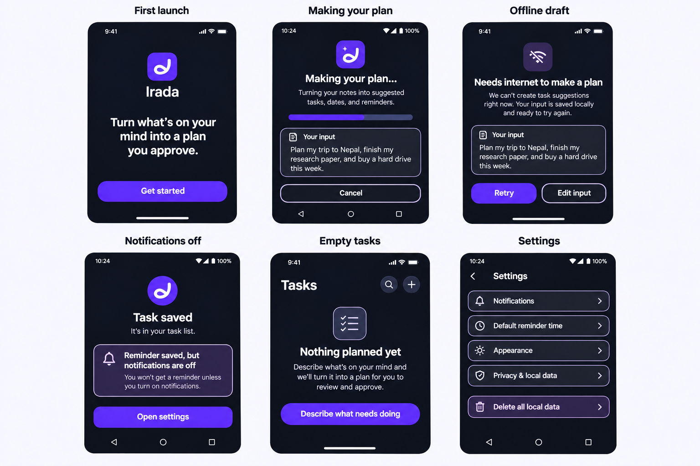

# Irada brand manual

Version 1.0 | 18 November 2026

Approved foundation; supporting decisions marked as proposals.

## 01 / Foundation - Intention, made clear.

### Final identity

Irada. Thought to Intent / Balanced Loop symbol. Primary purple #4B32F4. Soft Outline icon family. These decisions are approved.

### Personality

Calm, capable, warm and respectful. A thoughtful guide with a protective quality, never a boss. Reduce mental load; keep the person in control.

### Product promise

Describe what needs doing, review the proposed plan, and approve it before anything is saved or scheduled. Preserve drafts. Explain uncertainty. Suggest realistic dates without invented urgency.

### Voice

Use direct, reassuring language: "Review your plan", "Suggested", "Your draft is saved", "Retry". Avoid "AI knows best", guilt, streak pressure and claims that work is already done before approval.

### Approval status

Locked: name, core symbol, purple and icon style. Proposed for approval: supporting palette, Inter wordmark at 600, size/spacing rules and illustration system. Focus mode and any standalone triage destination require product approval; they are not part of the current v1 scope.

## 02 / Logo - A thought becomes intent.

### Construction

Use the existing editable SVG path. The loop holds a thought; the upright terminal suggests deliberate progress. Preserve its proportions, counter, rounded terminals and stroke relationship.

### Clear space

Define S as the visible symbol height, excluding SVG canvas padding. Keep at least 0.125 S clear on every side. For a horizontal lockup, use the same clearance and a symbol-to-wordmark gap of 0.20 S. This proposed rule supersedes the earlier half-stroke note.

### Minimum sizes

Proposed: standalone symbol at least 24dp/pt in UI or 8mm in print; horizontal lockup at least 112px wide or 30mm in print. At smaller sizes use the symbol alone. Confirm on real devices and print proofs.

### Correct

Purple symbol on white. White symbol on #11121A or on #4B32F4. Brand icon belongs in onboarding, app identity and launcher artwork. Keep action labels and recognizable completion controls.

### Incorrect

Do not stretch, rotate, add a dot or arrowhead, fill the inner counter, outline the ribbon, add glow, or use blue as the primary accent. Do not treat the app symbol as an unlabeled completion state. Symbol is not mirrored for RTL.

## 03 / Color - Purple leads. Contrast guides.

### Light palette

Primary #4B32F4; canvas #FFFFFF; card #F6F4FF; primary text #11121A; secondary text #5C5B6D; control border #777184; selection fill #E6E0FF with #4B32F4 text.

### Dark palette

Primary action #4B32F4 with #FFFFFF text; canvas #11121A; card #20212F; primary text #F5F3FF; secondary #BCB8CE; link/outline accent #C4B5FD; control border #817A95; selection #302754 with #E9E2FF text.

### Semantic colors

Light: error #B4233B on white, warning #7A4A00 on #FFF4D6, success #146C4D on white. Dark: error #FF9DAE on #20212F, warning #FFD58A on #3A2C13, success #83DDB8 on #20212F.

### Usage

Use base purple for filled actions on both themes; lavender is a supporting dark-theme foreground, not a replacement brand hue. Pair all status colors with text or shape. Do not use opacity to create untested text colors.

### Measurement limits

Ratios use WCAG relative luminance for opaque sRGB colors. Normal text target: 4.5:1; large text and essential non-text components: 3:1. These calculations do not establish app accessibility compliance; real font sizes, focus states, system controls, images and screen-reader behavior need testing.

## 04 / Type and craft - Quietly recognizable.

### Typography proposal

Brand wordmark: Inter SemiBold 600, title case Irada; retain live text in editable source. Marketing/body: Inter 400; labels 500; headings 600. Avoid heavy italics, condensed cuts and artificially stretched letters.

### Native UI

iOS: system SF Pro with Dynamic Type. Android: system Roboto with scalable sp. Suggested starting hierarchy: title 28/34, section 20/26, body 16/24, label 14/20. Treat these as starting values; allow wrapping and system scaling.

### Font sources and licenses

Inter: https://rsms.me/inter/ ; SIL OFL 1.1 at https://github.com/rsms/inter/blob/master/LICENSE.txt . Roboto: https://fonts.google.com/specimen/Roboto ; current upstream OFL 1.1 at https://github.com/googlefonts/roboto-3-classic/blob/main/OFL.txt . Retain license/copyright notices when bundling font files; follow reserved-name conditions for modifications.

### Apple font use

SF Pro source and license: https://developer.apple.com/fonts/ . Apple proprietary terms apply; use the platform system font for native Apple UI. Do not redistribute SF Pro as a cross-platform brand font. Reference: https://developer.apple.com/design/human-interface-guidelines/typography . Guide PDF uses Helvetica for portable review; final Inter typesetting remains proposed.

### Spacing and icons

4-unit spacing grid: 4, 8, 12, 16, 24, 32, 48. Start with 16-unit screen gutters and card padding, 12-unit gaps, 16-unit card radius. Soft Outline: 24x24 grid, 1.8-unit stroke, round caps/joins; 48dp Android and 44pt iOS minimum interactive targets. Never stretch glyphs to fill targets.

### Artwork direction

Flat, restrained loops and paths echo the logo: loose input becomes organized lanes. Generous negative space, no decorative AI sparks, glowing brains, gears or lightbulbs. Motion should clarify a transition and respect Reduce Motion. Use factual task examples rather than decorative dashboards.

## 05 / In context - One identity, four moments.

### Home / Inbox

Visible destination: Tasks. Show Overdue, Today, Upcoming and Anytime, followed by collapsed completed tasks. Small Irada identity, quiet cards, purple Add tasks action. A separate inbox is outside v1. Search and filter remain clearly labeled.

### Swipe / Triage

Use swipe as a shortcut within the task list, with equivalent labeled actions in task detail. Reschedule and Delete remain explicit; show Undo after routine changes. No swipe-only interaction or new triage tab. A dedicated triage mode needs approval.

### AI suggestions

Label values Suggested; keep original input reachable and uncertainty readable. Purple Approve tasks action marks the trust boundary. Do not imply suggestions are already saved. Keep reasons in plain language, not confidence percentages.

### Focus mode - concept only

A quiet single-task card, the Soft Outline focus brackets, lavender secondary controls and a purple Start focus action. Pause and sound use action labels. No countdown pressure, scores or streaks. Focus is an illustrative extension requiring scope approval.

### State and symbol rules

Selected state uses a tonal container plus native selected semantics and a visible label. Brand app icon replaces the onboarding checkmark; actual completed tasks keep conventional completion indicators. For voting, suggestions, triage, history, tips and mind map, preserve visible labels because their symbols can be ambiguous.

## 06 / Contrast audit - Measured pairs, not visual guesses.

| Role | Foreground | Background | Ratio | Normal text 4.5:1 |

|---|---|---|---|---|

| Button label | #FFFFFF | #4B32F4 | 6.86:1 | Meets numerical target |

| Light primary text | #11121A | #FFFFFF | 18.66:1 | Meets numerical target |

| Light secondary text | #5C5B6D | #FFFFFF | 6.62:1 | Meets numerical target |

| Light card secondary text | #5C5B6D | #F6F4FF | 6.08:1 | Meets numerical target |

| Light accent text | #4B32F4 | #FFFFFF | 6.86:1 | Meets numerical target |

| Dark primary text | #F5F3FF | #11121A | 17.02:1 | Meets numerical target |

| Dark card secondary text | #BCB8CE | #20212F | 8.25:1 | Meets numerical target |

| Dark accent text | #C4B5FD | #11121A | 10.11:1 | Meets numerical target |

| Selected label | #E9E2FF | #302754 | 10.87:1 | Meets numerical target |

| Light destructive text | #B4233B | #FFFFFF | 6.47:1 | Meets numerical target |

| Dark destructive text | #FF9DAE | #20212F | 8.10:1 | Meets numerical target |

| Light warning text | #7A4A00 | #FFF4D6 | 6.83:1 | Meets numerical target |

| Dark warning text | #FFD58A | #3A2C13 | 9.77:1 | Meets numerical target |

| Light success text | #146C4D | #FFFFFF | 6.40:1 | Meets numerical target |

| Dark success text | #83DDB8 | #20212F | 9.85:1 | Meets numerical target |

| Avoid: base purple text on dark | #4B32F4 | #11121A | 2.72:1 | Below target |

| Avoid: white text on lavender | #FFFFFF | #C4B5FD | 1.85:1 | Below target |

## 07 / Use and handoff - Consistency earns trust.

### Correct use

Use approved loop geometry, one purple filled primary action, light/dark tokens, native text scaling, visible Suggested labels and explicit approval. Keep task content readable and offline drafts recoverable.

### Incorrect use

Avoid distorted logos, purple body text on dark cards, white labels on lavender fills, unlabeled icon-only triage, permanent AI chat, and illustrations that imply automatic scheduling. Never use color alone to show overdue or completion.

### Mockup status

Updated iOS, Android and system-state raster boards use Irada purple and app-symbol branding. Their pixels are illustrative and may include generated text or color variance. Exact colors, task semantics and accessible interactions follow this manual and DESIGN.md, not sampled raster pixels.

### Review decisions

Approve or revise: supporting neutrals/lavender/semantic colors; Inter 600 wordmark; minimum size and clear-space rules; proposed spacing and artwork direction. Product decision separately required for Focus mode and a standalone triage destination. No additional approval needed for the already selected name, logo direction, purple or Soft Outline.

### Editable handoff

The guide source is brand-manual.md with a reproducible build_manual.py. Existing symbol and wordmark SVGs are editable vectors, not raster wrappers. The sharing PDF contains selectable text and vector logo examples; raster mockup boards remain PNG. No commit, push or publication has been performed.

## Review assets

